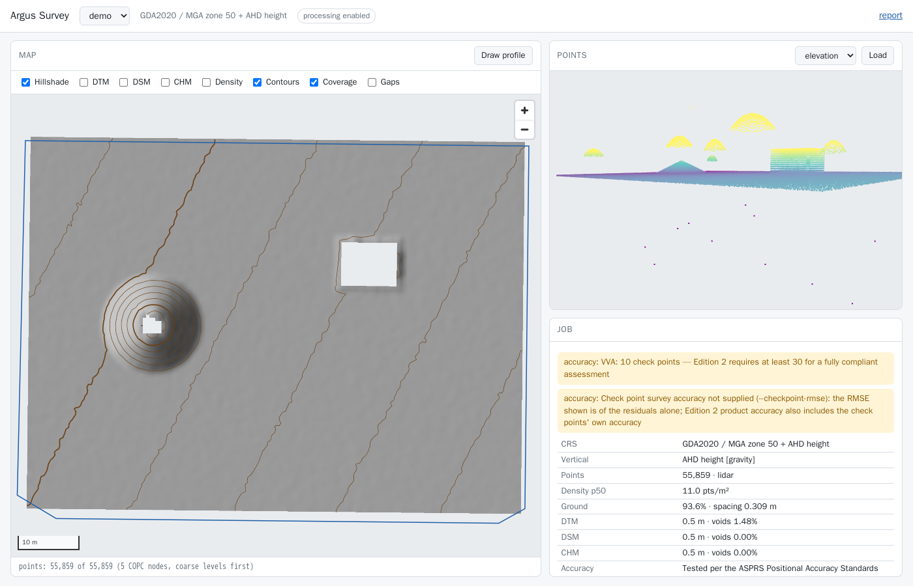

# argus-survey

**Point-cloud deliverables for land surveyors — with every datum, transformation and command on the record.**

Give it LiDAR, drone photogrammetry (LAS/LAZ/COPC) or terrestrial scans (E57) and it produces what a surveyor hands over: a QA report,
ground classification, DTM/DSM/CHM, contours, stockpile volumes, cut/fill against a design, long sections,
change between epochs and a vertical accuracy statement against check points (ASPRS Edition 2). Each job
ends in a printable `report.html` and a `job.json` that records the inputs' SHA256s, the CRS, the exact PROJ
operation and grid applied, and every PDAL pipeline and GDAL command in the order it ran.

It is built to be judged on **correct datums, honest numbers and reproducible outputs**:

- **No silent datums.** Heights without a vertical datum are refused for height work unless you say what
  they are (`--assume-vertical`), and then the report carries a red banner. A transformation that would need a
  missing geoid grid is refused — never quietly downgraded to a "ballpark" one (around Perth that is ~30 m).
- **Numbers come with their uncertainty.** Volumes state the cell size, void %, method and the base's fit;
  accuracy states n, exclusions, the standard and edition; change states its level of detection.
- **Tested against answers known in advance**: a cone stockpile of πr²h/3 on a tilted plane, a 1 m apex
  growth between epochs, ellipsoidal ⇄ AHD round trips through AUSGeoid2020 to the millimetre.

First audience: **Western Australian civil surveyors** (MGA2020 zones 49–51, PCG2020 and the other WA
LSG2020 grids, AHD via AUSGeoid2020). Nothing is hard-coded to WA; other regions work the same way.



## Five-minute start

You need Docker (with compose) and git. Everything else — PDAL 2.10, GDAL 3.13, PROJ 9.9 and the datum grids —
is inside the image.

```bash
git clone https://github.com/smk762/argus-survey && cd argus-survey
cp .env.example .env            # set UID/GID to `id -u` / `id -g`
make image                      # builds, then runs `argus-survey doctor --strict` inside
make demo                       # a synthetic site with known answers → data/jobs/demo
make up                         # API + viewer on http://127.0.0.1:8107/viewer
```

`data/jobs/demo/report.html` is the deliverable; open it in a browser and print it to PDF.

## Walkthrough on real, public LiDAR

```bash
make sample   # ~160k points of USGS 3DEP (public domain) → data/in/usgs-sample.laz

docker compose run --rm survey info /data/in/usgs-sample.laz
#   CRS: WGS 84 / Pseudo-Mercator (EPSG:3857) · vertical: none

docker compose run --rm survey run /data/in/usgs-sample.laz --job usgs \
    --assume-vertical EPSG:5703 --t-srs EPSG:6340+5703 --res 0.5 --interval 1
```

What that shows:

1. The file declares **no vertical datum**, so `--assume-vertical EPSG:5703` (NAVD88) is required for
   surfaces and contours — and is recorded and flagged as an assumption, never presented as fact.
2. Web Mercator "metres" are not ground metres (×1.2 at that latitude), so working in it is refused;
   `--t-srs` takes it to NAD83(2011) / UTM 11N + NAVD88 through one explicit PROJ operation. That
   operation is only accurate to ~2 m (WGS 84 → NAD83), and the job warns that it is not survey grade.
3. QA reports the density gaps; the DTM's 7 % voids are measured inside the coverage, not hidden by
   interpolation.

Then, for the same job, with your own polygon, line and check points in `data/in`:

```bash
docker compose run --rm survey volume  --job usgs --polygon /data/in/pile.geojson --base plane --surface dsm
docker compose run --rm survey profile --job usgs --line /data/in/xs1.geojson --step 0.5
docker compose run --rm survey accuracy --job usgs --checks /data/in/checks.csv --crs EPSG:6340+5703 \
    --checkpoint-rmse 0.02 --class-cm 10
docker compose run --rm survey report  --job usgs
```

Container paths: inputs are read from `/data/in` (mounted **read-only** from `./data/in`), jobs are written to
`/data/jobs` (`./data/jobs`). Point `SURVEY_IN_HOST`/`SURVEY_JOBS_HOST` in `.env` elsewhere if you like.

## WA datums in one table

| What you have | Ingest with |
|---|---|
| MGA2020 zone 50 + AHD, declared in the file | nothing extra — read and recorded |
| Drone output in GDA2020 lat/long + ellipsoidal heights (EPSG:7843) | `--t-srs EPSG:7850+5711` → AUSGeoid2020 applied, recorded |
| Drone output labelled MGA2020 z50 but heights are ellipsoidal | `--assume-vertical ellipsoidal --t-srs EPSG:7850+5711` |
| Heights known to be AHD, file says nothing | `--assume-vertical EPSG:5711` (flagged in red) |
| Working in a local grid (Perth metro) | `--t-srs EPSG:8031+5711` (PCG2020 + AHD) |
| Legacy GDA94 / MGA94 + AHD | `--t-srs EPSG:7850+5711`; pin the ICSM grid with `--operation "GDA94 to GDA2020 (2)"` when the data derive from state control |

MGA2020 zones 49/50/51 are EPSG:7849/7850/7851. WA LSG2020 grids: ALB2020 8013, BIO2020 8014, BRO2020 8015,
BCG2020 8016, CARN2020 8017, COL2020 8020, ESP2020 8021, EXM2020 8022, GCG2020 8023, GOLD2020 8024, JCG2020 8025,
KALB2020 8026, KAR2020 8027, KUN2020 8028, LCG2020 8029, MRCG2020 8030, PCG2020 8031, PHG2020 8032 (from
`projinfo --list-crs --area "Western Australia"`). Every transformation's candidates are listed in the report,
so the choice can be checked.

## Commands

| Command | Output |
|---|---|
| `doctor` | tool versions, PDAL/GDAL drivers, datum grids (SHA256-checked), key transformations |
| `info FILE` | header summary and CRS record (no job) |
| `ingest FILES… --job ID` | `points.copc.laz` in the job CRS; inputs pinned; datum settled; grid-to-ground scale factor (LAS/LAZ/COPC, or E57 with `--s-srs`) |
| `qa` | `qa.json`, `density.tif`, `boundary.geojson`, `gaps.geojson` |
| `ground [--method smrf\|csf] [--preset stockpile]` | `ground.copc.laz` (every point kept, reclassified; `stockpile` keeps steep piles as ground) |
| `surfaces --res R [--fill-voids N] [--chm-method max\|radius]` | `dtm.tif`, `dsm.tif`, `chm.tif`, void masks, `hillshade.tif` |
| `contours --interval I [--index N]` | `contours.gpkg`, `contours.geojson` |
| `volume --polygon P --base plane\|lowest-perimeter\|surface:T` | `volume.json` |
| `cutfill --design D.tif` | `cutfill.json` |
| `change --against EARLIER [--lod M \| --lod-from-accuracy]` | `change.json`, `dod.tif`, `dod_lod.tif` |
| `accuracy --checks C.csv --crs CRS` | `accuracy.json`, `accuracy_residuals.csv` |
| `profile --line L --step S` | `profile.csv`, `profile.svg` |
| `export --points las\|e57 [--polygon P] [--thin S]` | `points.las` (LAS 1.4, uncompressed) or `points.e57` for ReCap / Civil 3D, plus notes (CRS, class legend) |
| `report` | `report.html` |
| `run FILES…` | ingest → qa → ground → surfaces → contours → report |
| `synth OUT.laz` / `synth DIR --kit` | a synthetic scene with known answers; with `--kit`, every demo input written into `DIR` (truth in `kit-truth.json`; `--kit` can't be combined with `--epoch`, `--photogrammetry` or `--checks`) |
| `schema` | write the wire-contract JSON Schema UIs generate types from (`--check` in CI) |
| `serve` | API + viewer on :8107 |

Run any of them with `--help`. All job commands (everything except `doctor`, `info`, `synth`, `schema` and
`serve`) take `--job ID` (under `SURVEY_JOBS_DIR`) or `--out DIR`.

## How the numbers are made

- **Grids** are snapped: origin = ⌊min / res⌋ · res, so two epochs at the same resolution share cells exactly
  and a difference never needs resampling.
- **DTM**: inverse-distance weighting of ground points within res·√2 of each cell centre; a cell with none
  is a void, reported as a percentage of the *covered* area. **DSM**: the same over first returns — unbiased on
  stockpiles. (`--dsm-method max` exists for roofs and canopy; a binned maximum reads ≈ slope × res/2 high on
  slopes, ~6 % on a 1:2 pile at 0.25 m, so it is never the default.)
- **Volumes**: per-cell (upper − lower) × cell area, positive and negative summed separately, with boundary
  cells weighted by the fraction inside the polygon (`gdal raster zonal-stats --pixels fractional`). A plane
  base is a least-squares fit to surface heights sampled along the polygon boundary, with its RMS reported.
  More than 5 % voids in a polygon is refused unless you accept it.
- **Change**: later − earlier; |Δ| below the level of detection is "no detectable change". The LoD is given
  (`--lod`), or 1.96·√(σ₁² + σ₂²) from both epochs' accuracy statements (`--lod-from-accuracy`); with neither
  it defaults to 0.10 m, and `change.json`'s `lod_rule` says `default 0.1 m`.
- **Accuracy**: ASPRS Positional Accuracy Standards, Edition 2, Version 2 (2024), checked against the
  standard's text: RMSE only (Edition 1's 95 % figure is gone); the class is free-valued ("#-cm", NVA RMSE_V ≤
  #) and given with `--class-cm`; product RMSE_V = √(RMSE_V1² + RMSE_V2²) (§7.12.4), where `--checkpoint-rmse`
  is the surveyor's 1σ vertical RMSE; NVA pass/fail, VVA reported as found; min, max, mean, median, std and
  RMSE (§7.16); residuals beyond 3 × the target RMSE listed as blunders and a mean above 25 % of it flagged as
  bias (§7.2). Statements use §7.16.1's wording, including its reduced-checkpoint statement below 30 points. A
  check point is VVA only when the CSV's optional `description` column starts with `veg` or `vva`
  (case-insensitive); every other point, including one with an empty or missing description, is NVA and is
  pass/fail tested. Check points are given in a stated CRS and transformed through the same explicit operation
  machinery. Residuals are surface − check.
- **Drone-scale data**: ingest streams; the COPC is built out of core by untwine; filters that need
  neighbours (outliers, SMRF/CSF, height above ground) run on buffered tiles whose cores partition the site
  exactly — the tiles must add up to the source's point count before they are merged.

Areas and volumes are in the projection's **grid** units. MGA's line scale runs from 0.9996 on the central
meridian to about 1.0006 at a zone edge at WA latitudes, so grid areas and volumes can differ from ground by
up to ~0.1 %; the WA LSG2020 grids (PCG2020 etc.) exist to keep that negligible for engineering work.
Ingest records the **combined scale factor** at the site (point scale k from `proj -V`, with its range over
the extent, × the height factor R/(R+h) from the ellipsoidal height, reached through the same explicit
geoid operation), and volume/cut-fill reports give ground-scaled areas and volumes (grid ÷ combined²)
alongside the grid values.

## API and viewer

`argus-survey serve` (or `make up`) starts FastAPI on **:8107**. It is **read-only by default**: set
`SURVEY_ALLOW_PROCESS=1` to enable `POST /jobs/{id}/{step}`, which streams Server-Sent Events (each command,
warning, and the result). Inputs are named relative to `SURVEY_DATA_DIR`; products are fetched by
`(job id, kind)` with HTTP range support, so the viewer streams the COPC straight from the API.

| Route | Returns |
|---|---|
| `GET /health` | `{status, service, version, read_only, tools}`; `read_only` is `not SURVEY_ALLOW_PROCESS` |
| `GET /doctor` | the toolchain report (as `argus-survey doctor`) |
| `GET /inputs` | point clouds, vectors, rasters and CSVs under `SURVEY_DATA_DIR`, by name |
| `GET /jobs` | `{jobs: [JobDigest]}` |
| `GET /jobs/{id}` | the sidecar (`job.json`) |
| `GET /jobs/{id}/{kind}` | a product by kind (`copc`, `dtm`, `report`, …), with HTTP Range |
| `GET /jobs/{id}/web/{kind}` | map view: a raster → `{url, lon/lat corners}`; a vector → WGS 84 GeoJSON |
| `GET /jobs/{id}/web/{kind}/image` | the map view's EPSG:3857 PNG |
| `POST /jobs/{id}/{step}` | run a step (403 unless processing is allowed; 409 while the job is busy) |
| `GET /viewer` (`/` redirects) | the viewer |

`{step}` is one of `ingest`, `qa`, `ground`, `surfaces`, `contours`, `volume`, `cutfill`, `change`, `accuracy`,
`profile`, `report` or `run`, each with a JSON body whose fields mirror the CLI options (`IngestBody`,
`QaBody`, … `RunBody`; `report` takes `{}`). Two differences from the CLI: `volume` and `cutfill` accept a
drawn `polygon_geojson` (a WGS 84 Polygon/MultiPolygon geometry) instead of a `polygon` file, and `profile`
takes a drawn `line` (a WGS 84 LineString) or a `line_file`; drawn geometry is saved in the job dir under a
content hash so the recorded argv keeps pointing at it. `ingest` and `run` create the job; the other steps
need it to exist. The response is an SSE stream of `start`, `step`, `command`, `warning`, then `done` (the
step's result, product kinds, warnings) or `error`.

The request bodies, `HealthInfo`, the SSE payloads and `job.json` are all in one JSON Schema,
[`schema/survey-wire.schema.json`](schema/survey-wire.schema.json) (regenerate with `argus-survey schema`);
generate client types from it rather than from this table.

The viewer (`/viewer`) shows the hillshade, surfaces, density, change, contours and coverage on a map, the
classified cloud in 3D (coloured by elevation, class or intensity), the job's CRS and warnings, and — when
processing is allowed — draws a profile line and runs the profile step. It loads MapLibre, three.js and
copc.js (exact versions) from jsDelivr; all data comes from the API.

## Without Docker

```bash
micromamba create -p ./.geo -f env/geo-linux-64.lock   # the same PDAL/GDAL/PROJ the image uses
export PATH="$PWD/.geo/bin:$PATH" PROJ_NETWORK=OFF
projsync --target-dir ./.geo/share/proj --file au_ga_AUSGeoid2020_20180201.tif   # + the grids in env/proj-grids.sha256
make install && uv run argus-survey doctor
```

## Develop

```bash
make install      # uv venv with all extras
make lint         # ruff
make test         # pure-Python tests here; tool tests skip without PDAL
make test-docker  # the full suite in the image, tools required (what CI runs)
```

See [CLAUDE.md](CLAUDE.md) for the code map and conventions, [docs/runbook.md](docs/runbook.md) for
operations, [docs/data-sources.md](docs/data-sources.md) for public data and
[docs/atlas-showcase.md](docs/atlas-showcase.md) for turning a survey DTM into an argus-atlas map.
Follow-ups are [GitHub issues](https://github.com/smk762/argus-survey/issues) — Autodesk interoperability (LandXML, DXF, ReCap) first.

Part of the [Argus suite](https://github.com/smk762?tab=repositories&q=argus). MIT licence.
